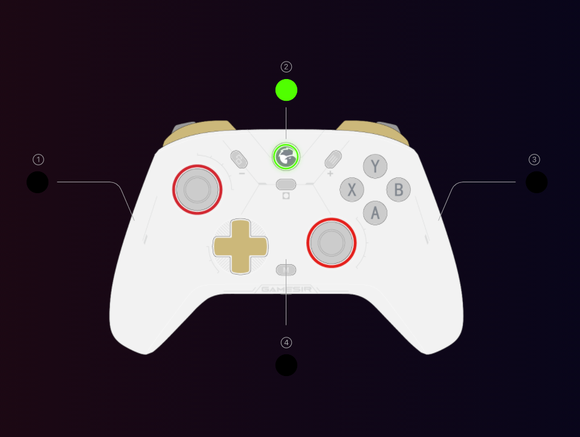

# 06 · Perfil de luz (perfil 32, 635 bytes)

Fontes: codec `Ks` (`main.app.js:7923`), editor do C2 (`renderer.js:135161`, rota `/C2/profileInfo/rgb`), presets (`renderer.js:28100`).

## Modelo

| | |
|---|---|
| Animações | 5 × até 8 keyframes; cada frame tem uma cor por zona |
| 0–3 | slots do usuário ("Animations"); no controle: **M + analógico esquerdo ←/→** |
| 4 | "Charging Light Effect"; não aparece na UI do C2 |
| Presets | só preenchem frames de um slot; não são modos do firmware |
| Desligar | frame todo preto; não existe flag |

## Layout

| Offset | Tam. | Campo | Valores |
|---|---|---|---|
| 0 | 1 | `ConfigIndex` | animação ativa 0–3 (app lê > 3 como 0) |
| 1 + 124·a | 124 | animação `a` (0–4) | abaixo |
| 621 | 1 | `AudioReactiveMode` | bit 0 — "Audio Reactive Mode" |
| 622 | 1 | `UserEffectIndex` | não usado pela UI; desconhecido |
| 623–625 | 3 | `ProfileLed` R,G,B | não usado pela UI; desconhecido |
| 626 | 1 | `RaiseWakeUp` | bit 0 — "Pick up to wake" |
| 627 | 1 | `StandbyTime` | minutos até dormir: 0 (nunca), 1, 5, 10, 20 |
| 628–634 | 7 | reservado | devolvido como lido |

### Animação

| Offset | Campo | Valores |
|---|---|---|
| +0 | `KeyFrameCount` | 1–8 |
| +1 | `EffectCount` | nunca alterado pela UI; 5 (zonas por frame) |
| +2 | velocidade | **byte = 20 − velocidade**; velocidade 0–20, maior = mais rápido |
| +3 | `Brightness` | 0–100 |
| +4 + 15·f | frame `f` (0–7) | 5 × RGB |

### Zonas no frame



*Tela de luzes do app com o controle conectado. ② (Home) aparece em `80,255,0`, a mesma cor lida no report `0x12`.*

⚠️ Ordem diferente do report `0x12` (`Home, LowerLeft, LowerRight, UpperLeft, UpperRight`). Fonte: `convertFrame` (`renderer.js:135365`), `updateRGB` (`renderer.js:135400`).

| Slot | Bytes | Nome no app | No Cyclone 2 | Nº na UI |
|---|---|---|---|---|
| 0 | +0..+2 | `LowerLeft` | lateral esquerda | 1 |
| 1 | +3..+5 | `LowerRight` | lateral direita | 3 |
| 2 | +6..+8 | `UpperLeft` | sem LED (UI não edita) | — |
| 3 | +9..+11 | `Home` | botão Home | 2 |
| 4 | +12..+14 | `UpperRight` | centro, junto ao botão M | 4 |

- Confirmado no hardware: cor só no slot 3 acende só o Home; cor nos 5 slots acende 4 LEDs (Home, as duas laterais e o do centro = luz 4), o que bate com o slot 2 sem LED.
- Luz 4: o espelho ao vivo da UI pinta essa cor em 4 barras de indicador de perfil (1–4).

## Presets

Aplicar um preset troca velocidade, `KeyFrameCount` e frames do slot; mantém brilho e `EffectCount`; frames restantes ficam pretos. Cores exatas em `lib/src/presets.ts`.

| Preset | Velocidade | Frames | Conteúdo |
|---|---|---|---|
| Flow | 17 | 5 | cor diferente por zona em cada frame; padrão do reset |
| Rainbow | 10 | 8 | todas iguais: vermelho, laranja, amarelo, verde, ciano, azul, magenta, vermelho |
| Pulse | 5 | 2 | roxo/rosa ↔ azul |
| Standoff | 10 | 1 | estático: Home branco, laterais azul/vermelho |
| Alarm | 18 | 6 | vermelho, apagado, vermelho, apagado ×3 |
| Off | 10 | 1 | preto |

Reset da tela: `StandbyTime` 10, `RaiseWakeUp` ligado, `AudioReactiveMode` desligado, brilho 100, Flow no slot atual.

## Pré-visualização na UI

| Momento | Pacote |
|---|---|
| Abre a tela | `0F 0D 01 01` |
| Pausa / seleciona keyframe `k` | `0F 0D 00 k+1` (controle mostra o frame parado) |
| Sai da tela | volta a tocar |

Cada edição regrava o perfil (debounce de 300 ms); o controle mostra o resultado após a escrita.

Validado com a lib: escrita de cor fixa, preset (Rainbow) e troca de animação ativa (`ConfigIndex`, refletido no byte 37 do `0x12`).

## Lib

```ts
await pad.setStaticColor("#00aaff");                  // todas as zonas, slot ativo
await pad.setStaticColor({ Home: "#ff0000" });         // só o Home
await pad.applyPreset("Rainbow");
await pad.setAnimation(animation([{ Home: "#f00" }, { Home: "#00f" }], { speed: 15 }), { slot: 3 });
await pad.setActiveAnimation(1);
await pad.setStandbyTime(5);
await pad.showFrame(0);
await pad.playLights();
```
